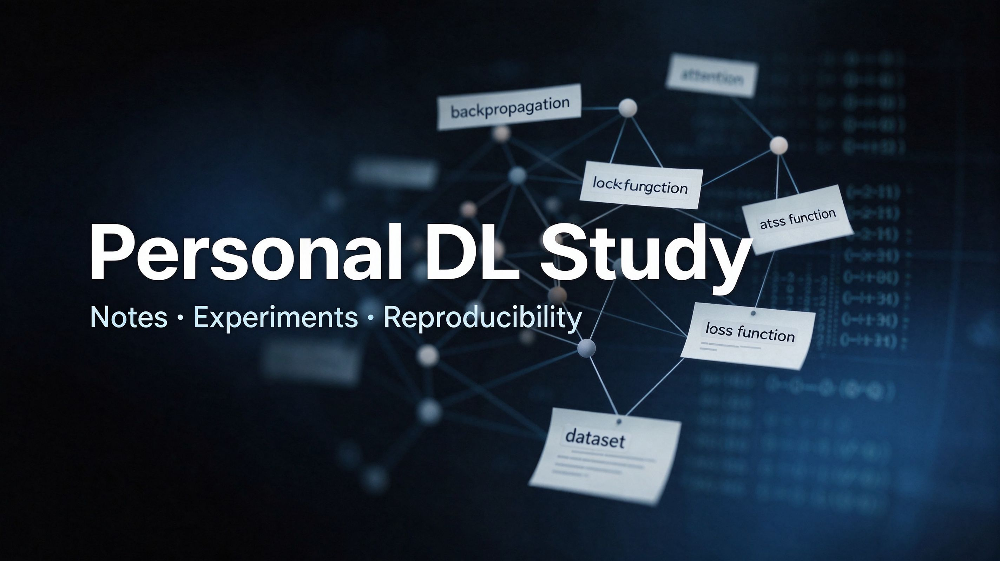

<div align="center">
  
</div>

# PyTorch 深度学习学习笔记

<div align="center">

**一份系统化的 PyTorch 深度学习学习笔记与示例代码**

从张量基础到卷积神经网络，逐步深入 · 持续更新中

</div>

---

## 关于本仓库

本仓库是我个人学习深度学习的**学习笔记与示例代码集合**。内容以 PyTorch 为核心，按照从基础到进阶的学习路径组织，每个知识点都配有：

- 📄 **带详细注释的示例代码**（编号 `.py` 文件）
- 📝 **系统化的总结笔记**（Markdown 文档，含 LaTeX 公式）

希望这些内容能对同样在深度学习路上的你有所帮助。

---

## 内容总览

| 模块 | 内容 |
|------|------|
| **张量基础** | 张量创建、数据类型、形状操作、索引、拼接、矩阵运算 |
| **自动微分** | `requires_grad`、`backward()`、正向/反向传播、`detach()` |
| **神经网络** | 网络搭建、前向传播、参数计算、`nn.Linear` |
| **激活函数** | Sigmoid、Tanh、ReLU、Softmax |
| **损失函数** | 二分类/多分类交叉熵、MSE、MAE |
| **参数初始化** | 全 0、Xavier、He（Kaiming）等 |
| **梯度优化** | 指数移动加权平均、Momentum、AdaGrad、RMSProp、Adam |
| **正则化** | Dropout、批量归一化（BN） |
| **卷积神经网络** | 卷积层 API、池化层 API、图像基础 |

---

## 目录结构

```
.
├── 01~33*.py                  # 按学习顺序编号的示例代码
├── ANN神经网络/                # 案例：手机价格预测（含数据集）
├── 损失函数/                   # 损失函数相关示例
├── 梯度优化方法/               # 优化器相关示例
├── imageData/                  # 图像处理示例数据
├── *.md                        # 学习笔记（见下方列表）
└── 其它 .png                   # 图示说明
```

---

## 学习笔记（Markdown）

这些是我整理的总结文档，配合代码一起看效果更好：

- [张量操作总结](./张量操作总结.md)
- [神经网络数据流动总结](./神经网络数据流动总结.md)
- [反向传播 BP 算法总结](./反向传播BP算法总结.md)
- [Sigmoid 激活函数总结](./sigmoid激活函数总结.md)
- [Tanh 激活函数总结](./Tanh激活函数总结.md)
- [ReLU 激活函数总结](./ReLU激活函数总结.md)
- [Softmax 激活函数总结](./softmax激活函数总结.md)
- [参数初始化方法总结](./参数初始化方法总结.md)
- [交叉熵损失函数总结](./交叉熵损失函数总结.md)

---

## 环境配置

| 项目 | 版本 |
|------|------|
| Python | 3.13.9 |
| PyTorch | 2.11.0+cpu |
| NumPy | 2.3.5 |
| 环境 | Anaconda |

示例代码可直接运行：

```bash
python "01张量基本创建方法.py"
```

---

## 免责声明

> ⚠️ **重要提示**
>
> - 本仓库内容**仅用于个人学习记录与知识分享**，不构成任何专业建议。
> - 笔记与代码可能存在**错误、遗漏或不准确之处**，请自行甄别与验证。
> - 作者**不对**因使用本仓库内容而产生的任何直接或间接损失承担责任。
> - 若发现错误，欢迎提出 Issue 或 Pull Request 帮助改进。

---

## 更新说明

🚧 **本仓库持续更新中**，内容会随着学习进度不断补充与完善。

---

## 许可证

本仓库仅供学习交流使用。
